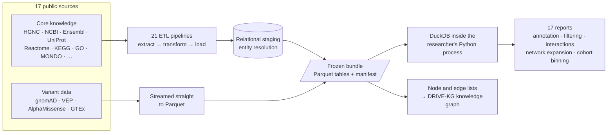

**Role:** lead and sole developer · University of Pennsylvania, Ritchie Lab · 2025 – 2026\
**Links:** [Repository](https://github.com/RitchieLab/biofilter) · [Documentation](https://biofilter.readthedocs.io) · [PyPI](https://pypi.org/project/biofilter/)

## In one paragraph

Genetic studies produce long lists of genes and variants. To make sense of them, researchers need
to know what each one does, which pathways it belongs to, which diseases it is linked to and how
it connects to the others. That knowledge exists, but it is spread across more than a dozen
public databases, each with its own names for the same things. Biofilter gathers it into one
versioned knowledge base and answers those questions with ready-to-use reports. Labs no longer
rebuild the same data for every study, and every result can be traced back to the exact version
of the knowledge it came from.

## The problem

**The same knowledge, rebuilt for every study.** Genomic analyses keep needing the same
biological knowledge: genes, variants, proteins, pathways, diseases, chemicals and the
relationships between them. Every source names things its own way. A single gene can appear
under an HGNC symbol, an NCBI ID, an Ensembl ID and a dozen historical aliases. Every source also
has its own file formats and release schedule. Rebuilding that integration for every study is
slow, hard to reproduce and impossible to audit. Two years later, nobody can say which version of
which database produced a given result.

**Massive variant data.** The gene and pathway knowledge is about 7 million rows. Variant
annotation is a different order of magnitude: population frequencies (gnomAD), predicted effects
(Ensembl VEP), pathogenicity scores (AlphaMissense) and gene-expression evidence (GTEx) add up
to **billions of rows**. Loading that into a relational database means a large server, long
loads and heavy indexing.

**Databases don't fit where the science runs.** Genomic analysis runs on closed
high-performance computing (HPC) clusters and, more and more, in isolated containers across
different cloud platforms. In those environments you usually can't run a long-lived database
server. Jobs are scheduled on nodes with no persistent services, network access is restricted,
and each container would need its own credentials, connections and copy of the data. A central
PostgreSQL server becomes a cost, a bottleneck under many concurrent jobs, and a single point of
failure.

## Architecture at a glance

## What I built

Biofilter is built around one idea: **build once, freeze it, reuse it everywhere**.

### Normalization: one internal term for many external names

Everything (genes, variants, proteins, pathways, diseases, GO terms, chemicals) is modeled as an
**entity** with a single internal identifier. Each source's names and IDs are stored as
**aliases** that point to it. Whether a researcher types `TP53`, `HGNC:11998`, an Ensembl ID or
an old alias, the input resolves to the same entity, and every relationship from every source
attaches to that one record. Conflicts and ambiguous names are reported, not silently guessed.

### The bundle architecture: mixed preparation, frozen Parquet output

- **21 data pipelines over 17 public sources:** HGNC, NCBI Gene, Ensembl, UniProt, Pfam,
  Reactome, KEGG, Gene Ontology, MONDO, BioGRID, ClinGen, ChEBI, the GWAS Catalog, gnomAD,
  Ensembl VEP, AlphaMissense and GTEx. Each one runs extract → transform → load, uses file-hash
  checks to skip unchanged sources, and supports selective rollback, restart and cleanup.
- **A mixed build in two branches.** The core knowledge needs transactions, because resolving an
  entity means asking what earlier sources already created. So it is prepared in a temporary
  relational staging database (SQLAlchemy 2.x, SQLite). Variant data has nothing to resolve, so
  it skips the database and is streamed straight to Parquet. That keeps a billion-row build fast
  and memory-bounded.
- **Everything ends up as Parquet with a catalog.** The output is a **bundle**: a dated directory
  of Parquet tables plus a manifest that lists every file, its row count and size, which source
  versions went in, and what each build step did.
- **Frozen by design.** A bundle is never updated in place. New data means a new bundle, and old
  bundles stay readable. A researcher can keep the exact version behind a paper and reproduce the
  analysis years later. Every report result carries the ID of the bundle it came from.
- **No server needed.** Researchers query a bundle with **DuckDB inside their own Python
  process**. On an HPC cluster, one copy on shared storage serves any number of concurrent jobs.
  In the cloud, the same bundle is mounted read-only into a container
  (`ghcr.io/ritchielab/biofilter`). There is no database to host, secure or keep running.

### A knowledge graph on plain files

The entity and relationship tables are a **node list and an edge list** stored as Parquet. That
gives a graph view of the knowledge (genes linked to pathways, proteins, diseases and GO terms)
that can be traversed with SQL, loaded into graph tools, or used to build larger graphs, all
without running a graph database. That is how Biofilter's data became the backbone of the
DRIVE-KG knowledge graph.

## What researchers use it for

Seventeen reports cover the tasks researchers ask for most. They run the same way from the CLI,
the Python API and notebooks, and new reports are added without touching the CLI.

- **Annotation and enrichment.** Turn a list of genes, variants, proteins, pathways, diseases or
  GO terms into a table of everything known about them, from every source, with the source named.
- **Filtering.** Narrow results by source, relationship type, allele frequency, predicted
  consequence, pathogenicity score, genomic region and other parameters.
- **Dynamic interaction modeling.** Pair genes or variants that share known biology, such as a
  pathway, a protein interaction or a regulatory link. Researchers can test only biologically
  plausible interactions instead of millions of blind pairs, and every pair comes with its
  supporting evidence.
- **Network expansion.** Start from a gene and walk its neighborhood: related entities, the
  variants inside it, and regulatory evidence around it.
- **Cohort binning.** Read a cohort's own VCF or PLINK files, match its variants to the bundle,
  and group rare variants into biological bins (by gene or pathway) for burden-style analyses.

## How I worked

I designed and built Biofilter alone, end to end: data model, ETL, the bundle format, the read
path, reports, CLI and Python API, tests, documentation, Docker image and production deployment.

I also managed the expectations of very different users. Statistical geneticists wanted
interaction models, bioinformaticians wanted raw tables and SQL, lab members wanted something
they could run in a notebook, and the infrastructure had to fit the cluster's rules. I captured
the major design choices in architecture decision records (ADRs). When the original design (a
shared PostgreSQL server) stopped fitting how people actually worked, I led the move to
serverless Parquet bundles and migrated every report to the new read path.

## Impact

- Its data powers the **13.8M-node knowledge graph** behind DRIVE-KG
  ([PSB 2026](https://psb.stanford.edu/psb-online/proceedings/psb26/rajagopalan.pdf)).
- **Paper in preparation:** using Biofilter to discover gene–gene interactions in
  **Alzheimer's disease**.
- Runs in production on Penn's HPC cluster (LPC) as a shared, read-only knowledge base for the
  lab's genomic studies, with no database server to maintain.
- Turns weeks of manual data assembly into a reproducible query against a frozen,
  citable version of the knowledge.
- Published on PyPI (`pip install biofilter`) and documented on Read the Docs.

## Stack

Python · SQLAlchemy · DuckDB · Parquet / PyArrow · pandas · SQLite · PostgreSQL · Click ·
pytest / tox · Sphinx · Docker
