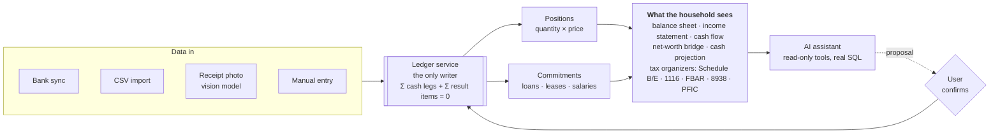

**Role:** designer and sole developer · personal project · 2026 – present\
**Links:** [Website](https://12true.com) · Repository (private, available on request)

## At a glance

- **What:** a household finance platform for families living between countries, built on a
  double-entry ledger, with bank connections, receipt reading, tax organizers and an AI assistant.
- **Scale:** ~1,080 commits in six months · ~1,700 automated tests · 46 architecture decision
  records · ~113k lines of Python and TypeScript.
- **Status:** in production and used daily by my own household.
- **Built end to end by me:** product, data model, backend, two web apps, public site, bilingual
  user guide, infrastructure and planning.

## In one paragraph

Families that live between countries carry two financial lives at once: a paycheck and a mortgage
in the US, an apartment and investments in Brazil, two currencies, two tax systems and a drawer full
of contracts. Budgeting apps see only one country and one currency, spreadsheets break under the
weight, and the obligations with the heaviest penalties (FBAR, PFIC, foreign tax credits) are the
ones nobody tracks. 12true brings all of it into one ledger built on real accounting rules. It
measures what actually matters, which is net worth and not income. It connects to US banks, reads
receipts from a photo, organizes the tax obligations of each country, and includes an AI assistant
that answers questions from the family's own data and never writes without the user's
confirmation.

## The problem

**Personal finance software measures the wrong thing.** Most apps ask "how much do I earn and how
much do I spend?" The more useful questions are different: how long can the family keep its
standard of living if income stops, and how far is it from investment income covering the cost of
living? Both have numeric answers, but only if the system knows assets, debts and cash flow
together, and knows them correctly.

**Savings are the budget line with no creditor.** Every bill demands to be paid; the future does
not. So in a bad month savings are the first thing to give, and they give silently. Withdrawing an
investment, skipping a contribution and selling an asset all look like "nothing left this month",
and nothing records that the family just paid itself less.

**Cross-border life is the base case, not an edge case.** For a Brazilian living in the US, the
hard problems are exactly the ones generic tools ignore: several currencies, assets with no market
price (a house, a car, a stake in a company), installment purchases, loans with escrow built into
the payment, and US reporting rules that reach accounts in Brazil. The market treats this
complexity as a premium feature. I see it as the reason the system should exist.

**Your financial data rarely belongs to you.** It sits with the bank, the aggregator or the app,
and the person gets read access to their own life. That is the wrong starting point for software
that will hold contracts, passports and bank credentials.

## Why I built it

I live this problem. My family's financial life is split between the US and Brazil, and I wanted a
single, auditable place to answer real questions: our net worth across both countries, the true cost
of owning our house, which accounts we must report to the IRS, and whether we are moving toward
financial independence or only feel like we are.

The product rests on five written **beliefs**. Each one is a claim someone could disagree with, and
each one turns into concrete product behavior:

| belief | what the system does because of it |
|---|---|
| Savings must not be the adjustment variable | Withdrawals and sales are named, shown and priced, never silent |
| Net worth is the measure, not income | The balance sheet is the central report; financial health and cash projection come from it |
| There is no anonymous expense | Every entry is classified; purchase rules and the assistant make that cheap |
| The data belongs to the user | Isolation in the database, column encryption, export; the AI proposes, the user confirms |
| The more you have, the harder it gets | Multi-country, multi-currency, documents and contracts are the base product, not a premium tier |

## Architecture at a glance

Every household's data is isolated by the database itself (row-level security).

## What I built

### An accounting core, not a transaction list

The heart of 12true is a **double-entry ledger with an invariant enforced on every write**:

    Σ cash legs  +  Σ result items  =  0

A single service is the only writer in the system, and it refuses any entry that does not balance.
That one rule removes whole classes of bugs. A loan payment is an ordinary entry. Its legs debit the
checking account and reduce the loan balance. Its items carry interest, property tax and insurance
to their own categories. The income statement never needs to know that a loan exists. A sale
of 0.2 BTC cannot be recorded without choosing a cost method (FIFO, average cost), because the
realized gain is the item that makes the entry balance. Once a gain is recorded it is never
recomputed. A number that changes after it went on a tax return is not a report; it is a problem.

### One model for accounts and assets

A checking account, a credit card, an ETF, a 401(k), a house and a bitcoin wallet are all the
same thing: a **position** with three axes (liquidity, nature and valuation). Value is always
`quantity × price`, where the price comes from the book, from a global market quote, or from an
appraisal. There is no special case per asset type. Quantity, ticker and currency are three separate
fields (`0.00293644 units of BTC, valued in USD`). Mixing quantity with money once made the test
net worth come out at 795 billion, and the model was redesigned so that bug cannot happen again.

### Three financial statements that reconcile

- **Balance sheet, income statement and cash flow** that tie out with each other, in any reporting
  currency (BRL, USD or EUR), plus a bridge report that answers *"I earned 8k, why didn't my net
  worth grow 8k?"*
- **Net worth at cost, market value in its own report.** If net worth were marked to market, it
  would move when bitcoin moves, and nothing in the income or cash statements would explain the
  change. So revaluation is an explicit, dated entry, and it is the only path from market value
  into net worth.
- **Commitments and plans:** salaries, leases and loans (PRICE/SAC amortization, extraordinary
  payments to shorten the term or reduce the installment) generate their future installments.
  Budgets and projects carry versions and a Plan × Actual view. A month-by-month cash projection
  shows when each credit card bill will hit and how much is left to save.

### Data that arrives on its own

- **Plaid integration (US banks)** with balance verification against the bank, pointing out exactly
  where the system and the bank disagree.
- **CSV import** for banks without a connection.
- **Receipt reading with a vision model:** photograph a receipt today, and when the bank sends the
  transaction tomorrow, the two are matched into one entry instead of a duplicate.
- **Purchase rules** with preview (`AMAZON MKTPL*` → Home/Shopping): classify once, not every week.

### A tax organizer, not a tax preparer

For each country the system collects and checks what the tax return will ask for. The person or
their accountant files. For the US it covers interest and dividends (Schedule B), rental income
property by property (Schedule E), foreign tax credit payment by payment at the day's exchange rate
(Form 1116), maximum yearly balance per foreign account for **FBAR and Form 8938**, and detection of
Brazilian funds that count as **PFICs** (Form 8621). A country shows up based on the person's
tax status and not only on where their accounts are. A green card holder whose accounts are all in
Brazil still sees the FBAR tab, because that is exactly who needs it.

### An AI assistant built on tools, not on RAG

The first version stuffed a summary of the user's finances into the prompt. It could not find a
specific transaction and could not change anything. The redesign recorded in an ADR splits the job
three ways. Product questions are answered from the bilingual user guide, which fits in the
prompt with caching. Data questions go through **tool calls that run real SQL**, because "how much
did I spend on the car in August" has an exact answer, and embeddings would return similar-looking
transactions, which is the wrong answer dressed up as a right one. Changes come back as
**proposals the user confirms**: nothing is written to the ledger behind the user's back. Each
household can bring its own API key to control cost and provider.

### Security designed in from the first model

- **Multi-tenancy enforced by the database, not by queries:** PostgreSQL Row Level Security.
  Every new model ships with an isolation test, and that rule blocks commits.
- **Column and file encryption** for bank credentials and sensitive fields, with key rotation and
  keys kept outside the database. A test reads the raw column with SQL and proves the plaintext is
  not on disk. Files are served only to authenticated users.
- **Sensitivity declared by type,** in three levels, which also decides what the AI assistant is
  allowed to see.

## How I managed it, end to end

I own every layer: product vision, data model, backend, two SPAs, public site, user guide,
infrastructure, deployment and planning.

**Decisions are written down.** The project keeps **46 architecture decision records** in an
append-only register. A decision that gets superseded is not edited away; a new ADR replaces it and
the old one stays as history. Each ADR records the context, the honest downsides and the conditions
under which it should be reopened.

**I measured, admitted what didn't work, and rebuilt.** The first version (FLS) was built from April
to September 2026 and taught a lot, all captured in 27 ADRs. Measured against its production
database, it had **one user and zero invitations sent in four months**. Nobody invites people to a
system that still requires typing bank statements by hand, and the data model had reached its limit:
transactions and receipts were separate tables, and accounts and assets were separate concepts. I
froze v1, designed v2 around the ledger invariant, and validated the new model in a throwaway lab
project first, with seven reference scenarios that had to pass without per-type exceptions. Then I
built v2 next to the frozen v1. Five weeks later v2 was in production with **zero commits needed in
v1**. I retired v1 completely: containers, DNS and databases, with the code archived for its history.

**Execution is planned and visible.** The road to a private beta is a GitHub Project epic, broken
into phases. Its entry rule is simple: *anything that protects a third party's data comes before
the third party*. A security, privacy and compliance gate (including Terms and Privacy under LGPD
and GDPR) must be passed before the first outside user is invited.

**I used AI deliberately.** I worked with Claude as an architecture consultant and pair programmer,
under explicit project rules: the ADRs govern, tests are mandatory before every commit, and the human
decides. Every ADR names the decision owner.

## Finance behind the product

- **Accounting as the foundation:** double-entry bookkeeping, accrual versus cash basis, cost basis
  and realized-gain methods, the link between the balance sheet, income statement and cash flow, loan
  amortization (PRICE and SAC), and cross-border tax reporting (FBAR, 8938, 1116, PFIC, Schedule E).
- **Clear about what it is not:** not a tax preparer, not financial advice, not a bank or a broker.
  It never sells or monetizes user data.

## What comes next

Monthly closing reports with a summary from the assistant, financial health ratios (savings rate,
runway, leverage, liquidity), a 12-month cash curve, and tax organizers for Brazil and Portugal.

## Status and scale

- In production at `12true.com` and used daily by my own household. A private beta with family
  and friends is in preparation.
- **~1,080 commits** in six months, **46 ADRs**, **~1,700 automated tests** (including tenant
  isolation on every model), running in parallel in about 3 minutes.
- ~64k lines of Python and ~49k lines of TypeScript across the API, the user dashboard and the
  operator console.
- Fully bilingual (Portuguese and English): user interface, public site and a 22-article user guide.
  Missing a translation fails the build on purpose.

## Stack

Python · Django 6 (plain views, no DRF) · PostgreSQL 16 with Row Level Security · cryptography ·
Plaid · LLM APIs (vision and tool use) · React 19 · TypeScript · Vite · Tailwind ·
Recharts · i18next · Eleventy · Docker · GitHub Projects
