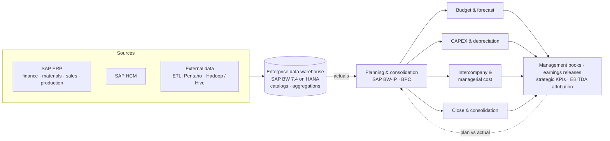

**Role:** Senior Consultant, FP&A and BI (2016 – 2018), then Senior Consultant, FP&A (2018 – 2021) · Klabin S/A, São Paulo\

## In one paragraph

I moved from BI into finance by building the FP&A area inside the data warehouse I had helped
create. From 2016 to 2018 I worked on both sides: integrating the company's financial information
and redesigning how it closed the books, built budgets and tracked strategy. In 2018 I left my BI
duties and dedicated myself to FP&A, where we matured the area, automated management calculations
and cut the time it took to publish results.

## The problem

Closing the month, building the budget and reporting results to leadership depended on data
spread across many systems and on manual work in spreadsheets. Every cycle took longer than it
should, and the numbers were hard to trace back to their source.

## Architecture at a glance

Close and reporting cycle: **about 4 days → less than 1 day**.

## 2016 – 2018: building FP&A into the data warehouse

FP&A was one of the last areas added to the enterprise data warehouse, and the one that brought
everything together.

- **Integrated all financial information** in the data warehouse, from SAP and other sources.
- **Redesigned the consolidation and management reporting process**, cutting the financial close
  and reporting cycle from about 4 days to less than 1 day through automation and validation layers.
- **Redesigned budgeting and planning processes**, with corporate budget and consolidation systems
  on SAP BW-IP and BPC.
- **Improved CAPEX planning.**
- **Strategic KPI monitoring** for leadership.
- **Automated reports, management books and earnings releases.**
- **An SAP HANA data platform on AWS** bringing data from many sources together.

## 2018 – 2021: dedicated to FP&A

With the platform in place, I moved fully into finance:

- **Matured the area's processes and analyses.**
- **Automated management calculations and chained results**, so changes upstream flowed through to
  every downstream result without manual rework.
- **Reduced the time to publish results.**
- Owned the core FP&A work: the annual budget, variance analysis of actuals against plan,
  product-mix and margin analysis, long-term projections, and reports for executive leadership.

## Key projects

| When | Project | What it delivered |
| --- | --- | --- |
| 2017 | **Value chain cost & EBITDA attribution** | An economic view of profitability across vertically integrated business units, from forest to paper |
| 2018 | **Management reporting automation platform** | Automated monthly financial and performance reviews across the organization |
| 2019 | **Integrated CAPEX planning & depreciation model** | One model for investment planning, maintenance spending and their impact on budget and forecast |
| 2020 | **Managerial cost & intercompany planning** | Pricing, inventory valuation and performance analysis across entities, separating accounting prices from managerial metrics |

## Why it matters

Few people in finance have built the data platform they work on. Having designed the data
warehouse, I could redesign the finance processes on top of it and automate them end to end.

## Stack

SAP BW-IP · SAP BPC · SAP BW 7.4 on HANA · AWS · SAP ERP (ECC)

No company figures or reports are published here.
